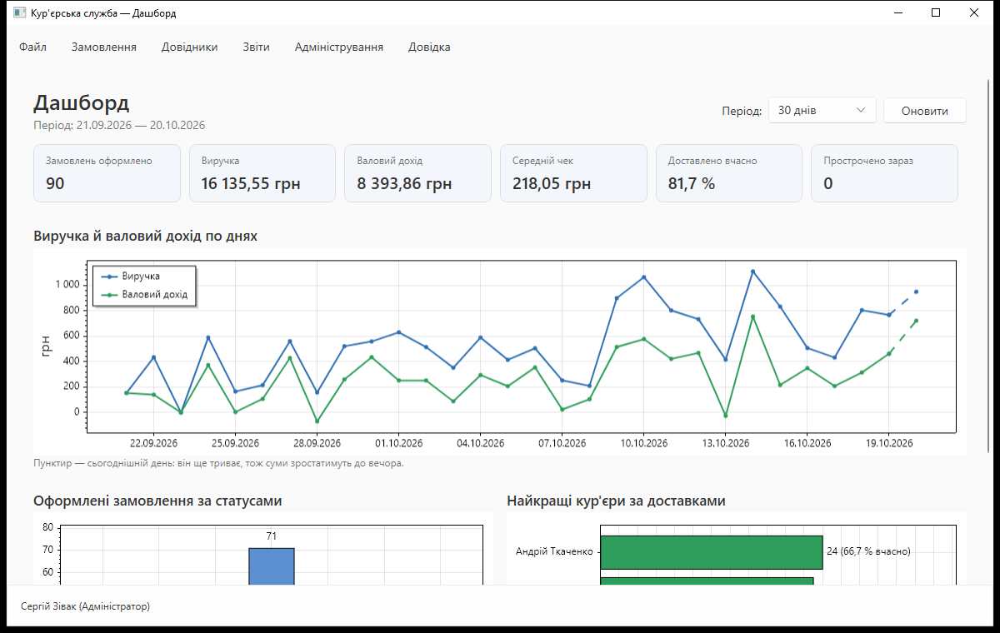
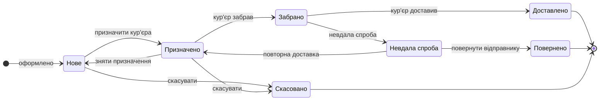
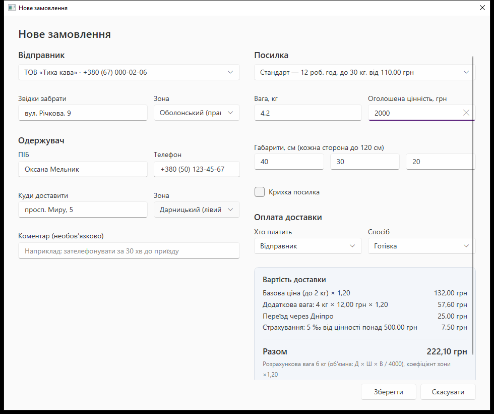
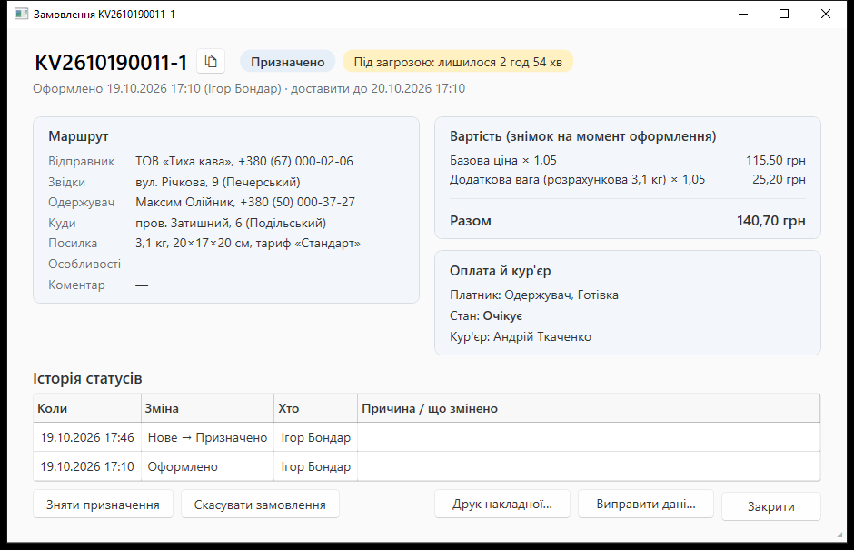
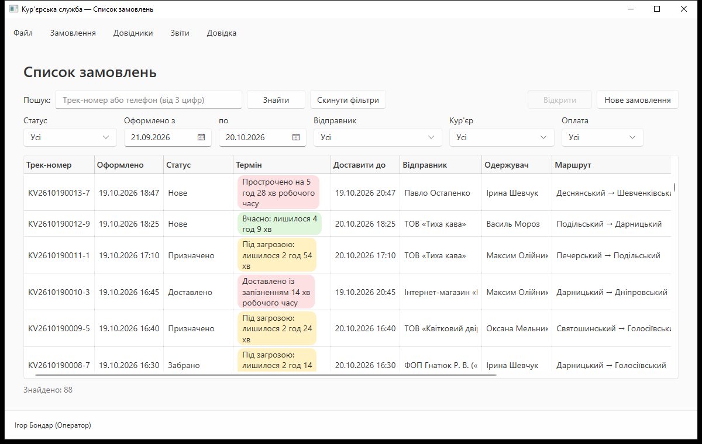
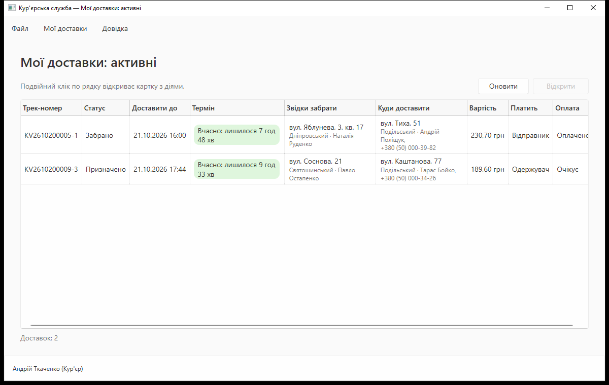
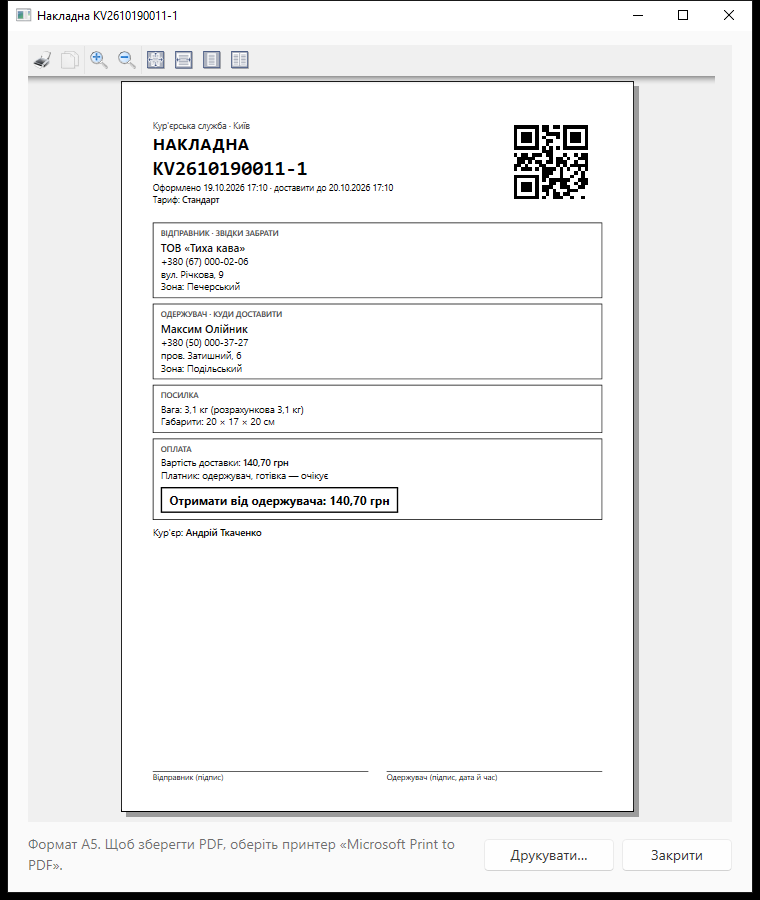
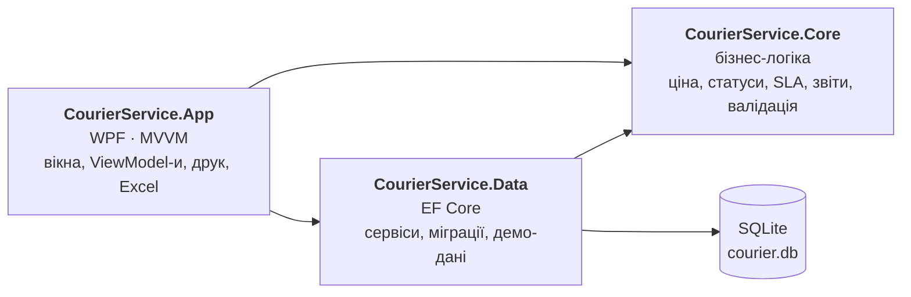

<div align="center">

# Кур'єрська служба

**Десктопна програма для кур'єрської служби в Києві:** замовлення з живим розрахунком вартості,<br>
призначення кур'єрів, контроль термінів, оплати, звіти й дашборд.

[](https://github.com/zivak0707-lang/courier-service/releases/latest)


### [⬇ Завантажити для Windows (zip, 72 МБ)](https://github.com/zivak0707-lang/courier-service/releases/latest/download/CourierService-1.0.0-win-x64.zip)

Один exe, встановлювати .NET не потрібно · [усі релізи](https://github.com/zivak0707-lang/courier-service/releases)



</div>

## Зміст

- [Швидкий старт](#швидкий-старт)
- [Можливості](#можливості)
- [Як рахується вартість](#як-рахується-вартість)
- [Життєвий цикл замовлення](#життєвий-цикл-замовлення)
- [Знімки екранів](#знімки-екранів)
- [Архітектура](#архітектура)
- [Тестування](#тестування)
- [Збірка з вихідного коду](#збірка-з-вихідного-коду)
- [Автор](#автор)

## Швидкий старт

1. Завантажте [zip з останнього релізу](https://github.com/zivak0707-lang/courier-service/releases/latest) і розпакуйте.
2. Запустіть `CourierService.App.exe`. Під час першого запуску програма сама створить базу з демо-даними.
3. Увійдіть під однією з демо-ролей:

| Роль | Логін | Пароль | Що побачите |
|---|---|---|---|
| Адміністратор | `admin` | `admin123` | показники дня, звіти, дашборд, довідники, користувачі, резервні копії |
| Оператор | `operator` | `operator123` | нові замовлення без кур'єра, прострочені, неоплачені; оформлення й призначення |
| Кур'єр | `courier1` … `courier4` | `courier123` | лише власні доставки й найближчий дедлайн |

> **Вимоги:** Windows 10 версії 2004 або новіша, x64.
> Exe не підписано цифровим підписом, тому Windows SmartScreen може попередити про невідомого видавця: «Докладніше» → «Виконати в будь-якому разі».

## Можливості

### Замовлення
- **Живий розрахунок вартості** з розбивкою на складові — ціна змінюється одразу під час введення ваги, габаритів, районів і тарифу.
- **Трек-номер з контрольною цифрою** (алгоритм Луна): `KV2610190042-6`. Описка під час ручного пошуку виявляється одразу.
- **Пошук і фільтри:** трек-номер, телефон, статус, період, кур'єр, клієнт, стан оплати.
- **Виправлення описок** в адресах і контактах оформленого замовлення — без зміни ціни, із записом в історію «було → стало».
- **Накладна A5 із QR-кодом** трек-номера — друк або збереження в PDF.

### Доставка
- **Автопризначення кур'єра з поясненням вибору:** серед активних кур'єрів, що витримують вагу, перевага тому, чия домашня зона збігається з місцем забору, далі — тому, хто на тому самому березі Дніпра, далі — найменш завантаженому.
- **Контроль термінів (SLA):** дедлайн рахується в робочих годинах служби 09:00–21:00; замовлення підсвічуються як «вчасно», «під загрозою» або «прострочено».
- **Кабінет кур'єра:** «Забрано», «Доставлено», невдала спроба з обов'язковою причиною, підтвердження отримання готівки.
- **Оплати:** платить відправник або одержувач; готівка, картка чи безготівковий розрахунок. Без підтвердженої оплати посилку не можна позначити забраною чи доставленою.

### Звіти й аналітика
- **Дашборд:** виручка й валовий дохід по днях, замовлення за статусами, найкращі кур'єри, частка вчасних доставок, прострочені зараз.
- **Звіти з експортом у Excel:** виручка (лише оплачені), неоплачені замовлення, ефективність кур'єрів, нарахування кур'єрам і валовий дохід служби.

### Надійність
- Перевірка кожного поля з підказкою біля нього, маски введення телефону й чисел; програма не падає на некоректних даних.
- Права ролей перевіряються не лише в меню, а й у сервісах.
- Паролі зберігаються лише як хеш PBKDF2 із сіллю.
- База створюється й оновлюється автоматично; щоденна та ручна резервні копії з відновленням.
- Журнал помилок у файлах, зрозумілі повідомлення замість технічних.
- Довідка до кожної сторінки за **F1**, меню «Допомога», «Про програму», «Вихід».

## Як рахується вартість

```
вартість = (база + доплата за кожен кг понад 2 кг) × коефіцієнт району
         + переїзд через Дніпро (якщо береги різні)
         + страхування (5 ‰ від оголошеної цінності понад 500 грн)
         + доплата за крихкість
```

Розрахункова вага — більша з фактичної та об'ємної (Д × Ш × В / 4000). Коефіцієнт району береться найбільший із двох точок маршруту: від 100 % у центрі (Шевченківський, Печерський) до 125 % (Деснянський).

| Тариф | Термін, робочих год | База (до 2 кг) | Кожен дод. кг | Макс. вага |
|---|:-:|:-:|:-:|:-:|
| Стандарт | 12 | 110 грн | 12 грн | 30 кг |
| Експрес | 4 | 150 грн | 15 грн | 20 кг |
| Термінова | 2 | 200 грн | 20 грн | 10 кг |

**Приклад.** Стандарт, 1,5 кг, Шевченківський → Дарницький: 110 грн × 1,20 = 132 грн + 25 грн за переїзд на лівий берег = **157 грн**.

Усі гроші в програмі зберігаються в копійках цілими числами — без похибок округлення дробових чисел.

## Життєвий цикл замовлення



Будь-який інший перехід програма відхиляє. Кожна зміна статусу записується в історію: хто, коли й чому.

## Знімки екранів

| Оформлення замовлення | Картка замовлення |
|:-:|:-:|
|  |  |
| **Список замовлень** | **Мої доставки (кур'єр)** |
|  |  |
| **Накладна з QR-кодом** | **Дашборд** |
|  |  |

## Архітектура



- **Core** не залежить ні від інтерфейсу, ні від бази: правила (розрахунок ціни, переходи статусів, терміни, автопризначення) — чисті класи, які легко тестувати. Час береться через `IClock`, тож правила термінів перевіряються на будь-яку дату.
- **Data** реалізує інтерфейси сервісів із Core; доступ до бази асинхронний, інтерфейс не зависає.
- **App** — WPF за шаблоном MVVM: ViewModel-и не знають про вікна й `MessageBox`, тому їх теж покрито тестами.

| Що | Чим |
|---|---|
| Мова й платформа | C# 14, .NET 10 |
| Інтерфейс | WPF, CommunityToolkit.Mvvm |
| База даних | SQLite, Entity Framework Core 10 |
| Графіки | ScottPlot |
| Експорт у Excel | ClosedXML |
| QR-код | QRCoder |
| Журнал | Serilog |
| Тести | xUnit |

## Тестування

936 автоматичних тестів xUnit (≈ 10 с):

- **Core** — розрахунок вартості, трек-номер і контрольна цифра, переходи статусів, робочі години й SLA, автопризначення, валідація телефонів і чисел, звіти;
- **Data** — сервіси на справжній SQLite у пам'яті: оформлення, призначення, оплати, права ролей, резервні копії;
- **App** — ViewModel-и: перевірка форм, живий розрахунок ціни, поведінка сторінок за ролями.

Окремо 21 сценарій прогнано в запущеній програмі (UI Automation) на стандартних і нестандартних даних: неправильний пароль і порожні поля входу, вага «1,2,3» і понад максимум тарифу, порожня форма, трек-номер з неправильною контрольною цифрою, дубль телефону клієнта в іншому форматі, коефіцієнт «abc», період «з» пізніше «по», відновлення бази з текстового файлу замість копії.

## Збірка з вихідного коду

Потрібен .NET SDK 10 (версію закріплено в `global.json`) або Visual Studio 2026.

```
dotnet build CourierService.slnx
dotnet test CourierService.slnx
dotnet run --project src/CourierService.App
```

Самодостатній exe одним файлом (як у релізі):

```
dotnet publish src/CourierService.App -p:PublishProfile=win-x64
```

<details>
<summary>Де програма зберігає дані</summary>

- База даних: `%LocalAppData%\CourierService\courier.db`
- Резервні копії: `%LocalAppData%\CourierService\backups\`
- Журнали: `%LocalAppData%\CourierService\logs\courier-РРРРММДД.log`

Щоб почати з чистими демо-даними, закрийте програму й видаліть файли `courier.db*` — під час наступного запуску базу буде створено заново.
</details>

## Автор

**Зівак Сергій Олександрович**, студент групи 471<br>
Фаховий коледж інформаційних систем і технологій «КНЕУ імені Вадима Гетьмана»<br>
Керівник — Литовка Л. В.

Курсовий проєкт з дисципліни «Інструментальні засоби візуального програмування», 2026.
